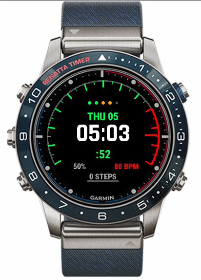
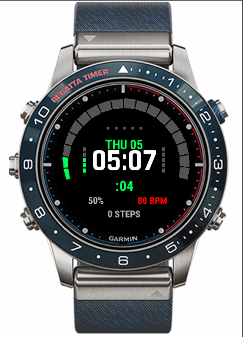
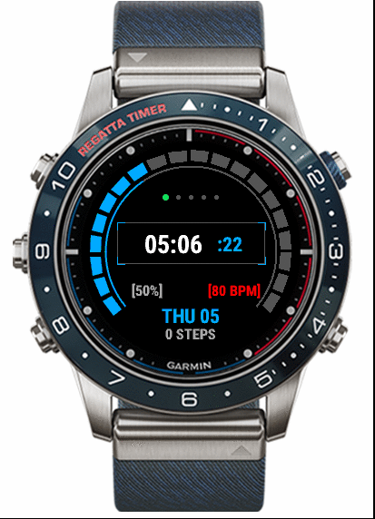

# 🏎️ ChronoGT — Racing Tachometer Watch Face for Garmin Connect IQ

<p align="center">
  <a href="https://apps.garmin.com/en-US/apps/a213d2da-0d13-4e02-ae58-3525fb89306a">
    
  </a>
  
  
  
  <a href="https://youtube.com/shorts/R3h-WX0FZ2w">
    
  </a>
  
</p>

<p align="center">
  <sub>The <a href="https://apps.garmin.com/en-US/apps/a213d2da-0d13-4e02-ae58-3525fb89306a">live Connect IQ store page</a> shows <strong>100+ downloads</strong> · 94 models · free · v1.0.0</sub>
</p>

<p align="center">
  <strong>A clean, motorsport-inspired digital & analog watch face paying homage to 90s JDM instrument clusters and Gran Turismo tachometers.</strong>
</p>

<p align="center">
  <a href="https://apps.garmin.com/en-US/apps/a213d2da-0d13-4e02-ae58-3525fb89306a">
    <strong>⬇️ Download Free on the Garmin Connect IQ Store</strong>
  </a>
</p>

> **Running ChronoGT on your wrist?** [⭐ Star the repo](https://github.com/robfernan/ChronoGT) so other Garmin folks can find it — and open an [issue](https://github.com/robfernan/ChronoGT/issues) with your watch model if anything feels off.

<p align="center">
  
  
  
  <br />
  <sub><strong>Layout 0: Classic JDM Analog</strong> &nbsp;·&nbsp; <strong>Layout 1: Honda S2000 AP1</strong> &nbsp;·&nbsp; <strong>Layout 2: 1985 Citroën BX 19 Digit</strong></sub>
</p>

---

## 📈 Launch Traction & Organic Milestones

Following its release on **October 23, 2026**:
- **100+ Downloads:** The [live Connect IQ store page](https://apps.garmin.com/en-US/apps/a213d2da-0d13-4e02-ae58-3525fb89306a) shows **100+ downloads** for ChronoGT Tachometer (free, v1.0.0).
- **Organic Social Conversion:**
  - **YouTube Shorts:** 193+ views (in 1 day, 18 hours) directly driving active installs from watch enthusiasts.
  - **DeviantArt:** 13+ views from digital design and automotive UI communities.
  - **Pinterest:** Early discovery pin indexing across motorsport & wearable design boards.
- **Physical Hardware & Simulator Validated Across Resolutions:**
  - **MARQ Captain (240×240 64-color MIP):** Perfect memory budget and zero text collisions under tight low-resolution constraints.
  - **Fēnix 8 47mm (454×454 AMOLED):** Ultra-sharp high-DPI contrast and vibrant night-mode luminous gauges.
  - **Vívoactive 5 (390×390 AMOLED):** Flawless proportional scaling across all 3 cluster styles with adaptive typography.

---

## ✨ Features

- **3 Authentic Racing Cluster Layouts (v1.1.0 - First Major Store Update):**
  - **Layout 0: Classic JDM Analog** (240° Defi / RX-7 perimeter sweep, needle, shift LEDs, center digital speedo).
  - **Layout 1: Honda S2000 AP1** (Signature progressive climbing tachometer arc, twin vertical flank bars for Battery & Steps, high-contrast digital speedo).
  - **Layout 2: 1985 Citroën BX 19 Digit** (Dual nested neon arcs, VFD bordered digital box with glowing corner brackets, and diagnostic tiles).
- **Universal Resolution-Adaptive Geometry:**
  - Dynamic `getTextDimensions` typography scaling guaranteeing zero text collision or overlapping elements across 218px, 240px, 260px, 280px, 360px, 390px, 416px, and 454px screens.
- **On-Watch Customization Menu (WatchUi.Menu2):**
  - Customize cluster layout, color themes, gauge modes, shift lights, and metric slots directly on your wrist using the native Garmin menu—zero phone required!
  - Full two-way synchronization with Garmin Connect Mobile settings.
- **240° Sweeping Racing Tachometer Gauge:**
  - Smooth outer gauge arc (`210°` to `330°` clockwise) with a designated **Redline Zone** (`75%–100%`) and hardware anti-aliasing.
  - Sweeping perimeter needle indicating live seconds without cluttering the center display.
- **Sequential 5-LED Shift Lights:**
  - F1 / JDM progressive shift indicator (`Green → Green → Amber → Amber → Redline`) that illuminates dynamically as the seconds hand approaches the redline.
- **Instant-Read Telemetry Dashboard:**
  - **Top:** Day of week & date (`FRI 23`)
  - **Center:** Crisp oversized digital time (`HH:MM`, 12h/24h aware) + live `:SS` seconds counter
  - **Bottom:** Battery `%` (turns redline at `≤ 20%`), live Heart Rate (`BPM`), and `STEPS` with an integrated step-goal progress bar
- **Zero-Allocation Ultra-Low-Power Engine:**
  - Cached property state and hoisted vectors to minimize CPU wake cycles and maximize battery life on MIP and AMOLED displays.
- **4 Signature Racing Cluster Colorways:**
  - **JDM Amber (#FFAA00):** Warm 90s instrument cluster glow.
  - **Redline Red (#FF2200):** Aggressive high-contrast sport trim.
  - **Track Cyan (#00CCFF):** Modern motorsport digital display.
  - **Tach Green (#00FF66):** Classic endurance racing telemetry.
- **AMOLED Always-On Display (AOD) Burn-In Safe:**
  - Micro-pixel drift mode (`onEnterSleep`) to prevent screen burn-in on AMOLED displays while preserving battery life.
- **Exceptional Memory & Battery Efficiency:**
  - **Only 3.5 KB runtime memory footprint** (0.45% of available watch RAM).
  - 100% vector mathematics (`dc.drawArc()`, `dc.fillPolygon()`) with zero heavy raster backgrounds.

---

## 📁 Repository Structure

The project follows the standard Garmin Connect IQ enterprise directory layout:

```text
ChronoGT/
├── .gitignore                      # Hardened git ignore (blocks RSA keys & build temp)
├── LICENSE                         # Official MIT License
├── README.md                       # Documentation & store assets
├── manifest.xml                    # Application manifest & 94 certified devices
├── monkey.jungle                   # Connect IQ build configuration
├── bin/
│   └── ChronoGT.iq                 # Store release package (1.4 MB universal binary)
├── docs/
│   └── assets/                     # Store graphics, hero banner & preview animations
│       ├── cover_500x500.png       # 500x500 store cover image
│       ├── hero_banner.png         # 1440x720 featured store banner
│       ├── preview.gif             # Animated 10 FPS demonstration
│       ├── preview.png             # Static high-res render on Venu 3 bezel
│       ├── screen_image.png        # Compressed store screenshot (< 150 KB)
│       └── social_preview.png      # 1280x640 GitHub Open Graph card
├── resources/
│   ├── drawables/                  # Launcher icon & XML definitions
│   ├── settings/                   # Garmin Connect Mobile property definitions
│   └── strings/                    # Localized string resources
├── scripts/
│   ├── record.sh                   # Automated frame recorder & GIF pipeline
│   ├── record_60s.sh               # 60-second 1080x1920 YouTube Short recorder
│   └── run.sh                      # One-click compile & simulator launcher
└── source/
    ├── ChronoGTApp.mc              # Application lifecycle & settings listener
│   ├── ChronoGTMetrics.mc          # Zero-allocation telemetry string cache
│   ├── ChronoGTSettingsMenu.mc     # On-device WatchUi.Menu2 customization interface
│   └── ChronoGTView.mc             # Procedural 2D vector drawing engine (Layouts 0, 1, 2)
```

---

## ⌚ Supported Garmin Devices (159 Round Color Models)

Pre-compiled and certified in `bin/ChronoGT.iq` across 159 round color Garmin watches (Connect IQ 3.2+), including:
- **Venu Series:** Venu 3, Venu 3S, Venu 2, Venu 2 Plus, Venu 2S, Venu, Venu Sq 2
- **Fēnix Series:** fēnix 8 (43mm/47mm/51mm/Solar), fēnix E, fēnix 7/7 Pro/7S/7X, fēnix 6/6 Pro/6S/6X, fēnix 5 Plus
- **Forerunner Series:** Forerunner 965, 265, 265S, 955, 255, 255S, 745, 245, 165
- **Epix Series:** epix (Gen 2), epix Pro (42mm/47mm/51mm)
- **MARQ Series:** MARQ Gen 2 & Gen 1 (Athlete, Adventurer, Aviator, Captain, Commander, Golfer)
- **Vívoactive & Enduro:** vívoactive 5, vívoactive 4/4S, Enduro, Enduro 2, Enduro 3
- **D2 & Descent Series:** D2 Mach 1, D2 Mach 2 Pro, Descent Mk2, Descent Mk3

---

## 🚀 Installation & Sideloading

### Option 1: Garmin Connect IQ Store
Download [**ChronoGT Tachometer** on the Connect IQ Store](https://apps.garmin.com/en-US/apps/a213d2da-0d13-4e02-ae58-3525fb89306a) directly via the Connect IQ mobile app on iOS or Android.

### Option 2: Direct Binary Sideload (.iq)
1. Download `ChronoGT.iq` from the [Latest GitHub Release](https://github.com/robfernan/ChronoGT/releases/latest).
2. Connect your Garmin watch to your computer via USB.
3. Place the extracted `.prg` for your device into the `GARMIN/APPS` folder on the watch storage.

---

## 🛠️ Developer Setup & Local Simulation

### Prerequisites
- Garmin Connect IQ SDK `9.3.0+`
- Developer RSA Key (`~/.Garmin/ConnectIQ/developer_key.der`)

### Build & Run
```bash
# Run locally in the Garmin Simulator
./scripts/run.sh venu3

# Build store package (.iq) supporting all 94 devices
monkeyc -e -r -f monkey.jungle -o bin/ChronoGT.iq -y ~/.Garmin/ConnectIQ/developer_key.der -w
```

---

## 💬 Community Testing & Feedback

This project was developed, type-checked, and simulated using the official **Garmin Connect IQ SDK 9.3.0** hardware emulator. 

Since I do not own every physical Garmin watch model, community feedback is invaluable! If you test ChronoGT on your physical device:
- Please report your watch model and performance.
- Have a feature request or layout idea? Feel free to open an issue or feature suggestion on [GitHub Issues](https://github.com/robfernan/ChronoGT/issues).

---

## 🗺️ Roadmap & Next Milestones

- [x] **v1.0.0 — Initial Launch:** 240° sweeping tachometer, progressive 5-LED shift lights, live health telemetry, and universal device compatibility.
- [x] **v1.1.0 — The Multi-Cluster Update (First Store Update):** Added 3 distinct authentic instrument clusters (Classic JDM, Honda S2000 AP1, Citroën BX 19 Digit), on-watch customization menu (`WatchUi.Menu2`), universal resolution-adaptive geometry across 159 certified models, :55-:59 redline pulse, and configurable dual metric slots.

---

## 📄 License

This project is licensed under the [MIT License](LICENSE) — see the LICENSE file for details.

---

## 👤 Author

**Robert Fernandez** — Cross-Platform Software Engineer & Digital Artist
- **Portfolio:** [robertfernandez.dev](https://robertfernandez.dev)
- **GitHub:** [@robfernan](https://github.com/robfernan)
