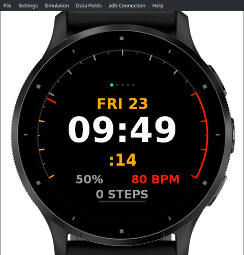

# 🏎️ ChronoGT — Racing Tachometer Watch Face for Garmin Connect IQ

<p align="center">
  
  
  
  
</p>

<p align="center">
  <strong>A clean, motorsport-inspired digital & analog watch face paying homage to 90s JDM and Gran Turismo instrument clusters.</strong>
</p>

<p align="center">
  
</p>

---

## ✨ Features

- **240° Sweeping Racing Tachometer Gauge:**
  - Smooth outer gauge arc (`210°` to `330°` clockwise) with highlighted **Redline Zone** (`75%–100%`) and hardware-accelerated anti-aliasing (`dc.setAntiAlias(true)`).
  - Sweeping perimeter needle that never obscures the central digital time readout.
- **Sequential 5-LED Shift Lights:**
  - F1 / JDM-style progressive shift indicator (`Green → Green → Amber → Amber → Redline`) above the date that illuminates as the gauge approaches redline.
- **Instant-Read Digital Telemetry:**
  - **Top:** Day of week & Date (`FRI 23`)
  - **Center:** Crisp oversized `HH:MM` (12/24-hour aware) + live `:SS` seconds counter
  - **Bottom:** Battery `%` (turns redline at `≤ 20%`), live Heart Rate (`BPM`), and `STEPS` with an integrated step-goal progress bar
- **Customizable via Garmin Connect Mobile / Express (`settings.xml`):**
  - **4 Cluster Accent Themes:**
    1. **JDM Amber (`#FFAA00`)** — Classic warm phosphor/instrument cluster glow *(Default)*
    2. **Track Red (`#FF2200`)** — High-contrast motorsport red
    3. **Nismo Cyan (`#00CCFF`)** — Modern digital telemetry blue
    4. **Retro Lime (`#00FF66`)** — Late-90s backlit LCD green
  - **3 Tachometer Gauge Modes:**
    - *Live Seconds Sweep (`0–60s`)*
    - *Daily Step Goal RPM*
    - *Heart Rate Zone RPM*
  - **Shift-Light Toggle:** Enable or disable the 5-LED shift-light array.
- **AMOLED Always-On Display (AOD) Burn-In Protection:**
  - Automatically enters a minimal, low-power pixel-shifting mode (`onEnterSleep`) on AMOLED watches to protect the display and maximize battery life.
- **Ultra-Lightweight Footprint:**
  - Uses only **`~8.6 kB`** of runtime memory—100% procedural 2D vector rendering with zero bloated bitmap backgrounds.

---

## ⌚ Supported Garmin Devices

Configured out of the box in [`manifest.xml`](manifest.xml) for round AMOLED and Solar MIP Garmin watches (and easily extensible to all 160+ Connect IQ 3.2+ devices):
- **Garmin Venu® 3** (`venu3`)
- **Garmin fēnix® 8 Solar 51mm** (`fenix8solar51mm`)
- **Garmin fēnix® 7** (`fenix7`)
- **Garmin epix™ (Gen 2)** (`epix2`)
- **Garmin Forerunner® 265** (`fr265`)
- **Garmin D2™ Mach 1** (`d2mach1`)

---

## 🛠️ Building & Running in the Simulator

### Prerequisites
- Garmin Connect IQ SDK `9.x` (`monkeyc` and `simulator`)
- Developer RSA-4096 key (`~/.Garmin/ConnectIQ/developer_key.der`)

### Quick Run (Linux)
```bash
./run.sh venu3
```

### Package Store Release (`.iq`)
```bash
monkeyc -e -r -f monkey.jungle -o bin/ChronoGT.iq -y ~/.Garmin/ConnectIQ/developer_key.der -w
```

---

## 👤 Author

**Robert Fernandez** — Cross-Platform Software Engineer & Digital Artist
- **Portfolio:** [robertfernandez.dev](https://robertfernandez.dev)
- **GitHub:** [@robfernan](https://github.com/robfernan)
